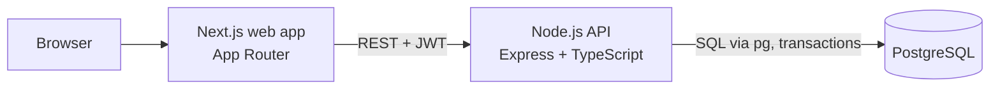
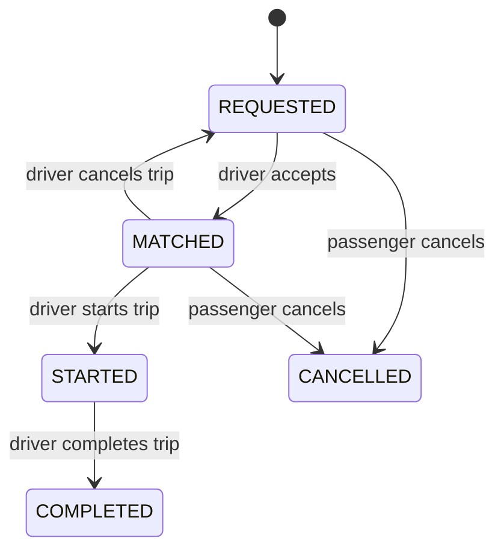
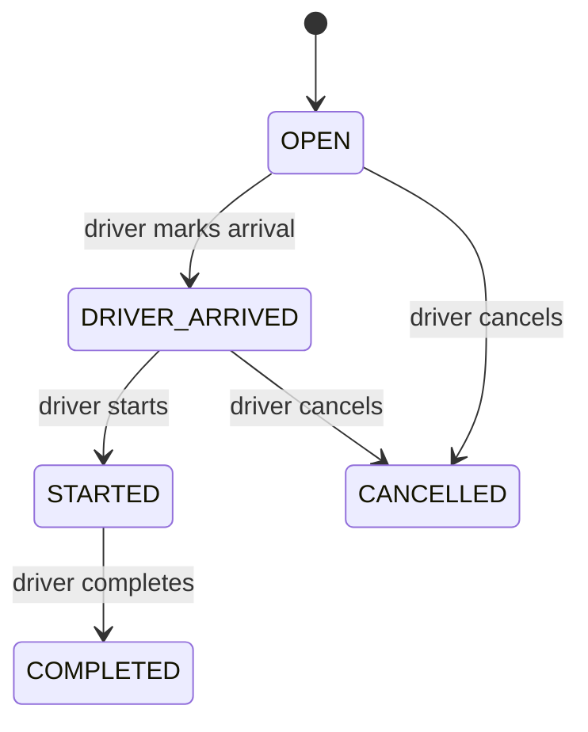
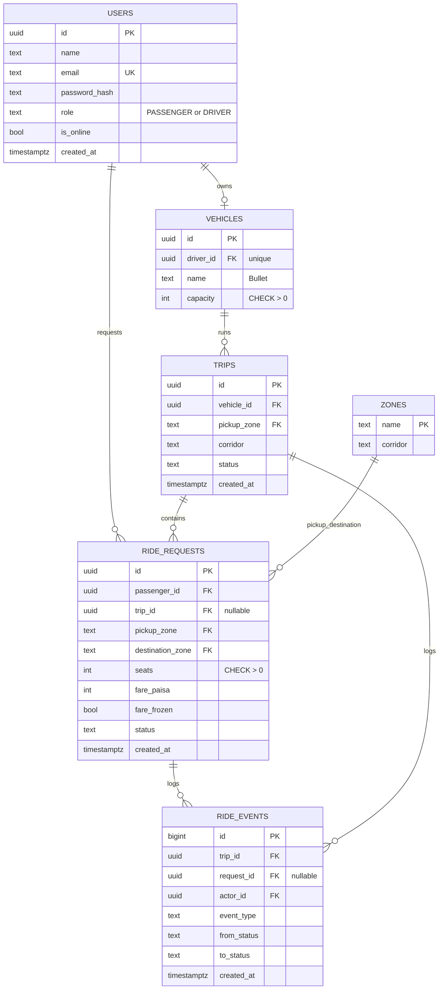

# Dhaka Tesla Pool: Architecture

> Share a seat. Split the fare. Survive Dhaka traffic.

This document is written before implementation. If the implementation diverges, this file is updated in the same commit.

## 1. System overview



- **Single API, single DB.** No queues, cache, or microservices; there is no problem in the MVP that needs them.
- **Business logic lives in the API service layer**, never in the frontend or in route handlers.
- **Real-time = polling** (every ~3 s). Chosen for simplicity; see "Scaling" for the upgrade path.

### Request path
`Route (Zod validation) → auth middleware (JWT + role) → service (rules, transaction) → SQL → audit event`

## 2. Actors and lifecycles

Actors: **Passenger** (Nusrat, Rafiq, Shirin), **Driver** (Jashim, owns **Bullet**, capacity 3), **Trip** (the pool).

Two state machines, because a passenger can cancel while the trip continues for others.

**Ride request (per passenger)**



**Trip (per Tesla run)**



Rules:
- Any transition not drawn above is rejected with `409 INVALID_TRANSITION`.
- A passenger may cancel only while their request is `REQUESTED` or `MATCHED` (i.e. before `STARTED`).
- If a driver cancels an unstarted trip, its passengers return to `REQUESTED` (they are not stranded).
- Passengers see their own request status plus the trip status (so "driver arrived" is visible).

## 3. Geography and matching rule

No routing engine. A fixed table of zones, each with a **corridor**, and a fixed distance table.

| Zone | Corridor |
|---|---|
| Banani | (pickup only in MVP demo) |
| Mohakhali | North-East |
| Gulshan 1 | North-East |
| Bashundhara | North-East |
| Uttara | North |
| Farmgate | Central |
| Dhanmondi | Central |
| Mirpur | West |

Distances (metres) are stored in a `zone_distances` table (symmetric, one row per pair) and seeded in a migration. Demo values from Banani: **Mohakhali 2,500**, **Gulshan 1 3,500**.

**Matching rule.** A request may join a trip if:
1. `request.pickup_zone == trip.pickup_zone`, and
2. `corridor(request.destination) == trip.corridor`, and
3. `trip.status = OPEN` (driver has not yet started), and
4. seats fit (Section 6).

A trip's pickup zone and corridor are fixed by the first request the driver accepts. Nusrat (Banani → Mohakhali) and Rafiq (Banani → Gulshan 1) are compatible: same pickup, both North-East.

**Matching is driver-initiated.** An online driver sees compatible `REQUESTED` rides and accepts them. This avoids building a matching engine and keeps the "who is riding" decision with Jashim.

## 4. Fare model

All money is stored as **integer paisa** (৳1 = 100 paisa). Floats cannot represent most decimal amounts exactly, and a fare must be reproducible by hand and in tests.

```
gross    = (BASE + PER_KM × distance_km) × seats
discount = floor(gross × 20 / 100)      if trip has ≥ 2 passengers, else 0
fare     = gross − discount
```

Constants: `BASE = 5000` paisa, `PER_KM = 2500` paisa/km, pool discount `20%`. Distance km comes from metres, so `PER_KM × metres / 1000`, computed in integer arithmetic.

**Hand check (Nusrat and Rafiq, 1 seat each, pooled in Bullet):**

| Passenger | Distance | Gross | Discount 20% | Fare |
|---|---|---|---|---|
| Nusrat (Banani → Mohakhali) | 2.5 km | 5000 + 6250 = 11,250 | 2,250 | **9,000 paisa = ৳90** |
| Rafiq (Banani → Gulshan 1) | 3.5 km | 5000 + 8750 = 13,750 | 2,750 | **11,000 paisa = ৳110** |

When fares are computed:
- At request time the passenger sees a **solo estimate** and the **pooled estimate**.
- On match, the discount is applied to all members and **recomputed if membership changes** before the trip starts (e.g. Rafiq cancels, Nusrat's discount goes away).
- At `STARTED` the fare is **frozen** and stored on the request.

Payment: **cash only** (simulated TeslaPay wallet is out of scope, documented as a cut).

## 5. Database design



`zone_distances(zone_a, zone_b, meters)` is a lookup table (not shown above for brevity).

Key constraints and indexes:
- `vehicles.capacity CHECK (capacity > 0)`, `ride_requests.seats CHECK (seats > 0)`.
- `CHECK (pickup_zone <> destination_zone)`.
- Status columns constrained to their allowed values.
- **One active trip per vehicle:** partial unique index on `trips(vehicle_id) WHERE status IN ('OPEN','DRIVER_ARRIVED','STARTED')`.
- `ride_requests(status, pickup_zone)` for the driver's "available requests" query; `ride_requests(trip_id)` for seat sums; `ride_requests(passenger_id, created_at DESC)` for history.
- `ride_events` is append-only; every transition writes a row in the same transaction, so history explains exactly what happened.

## 6. Concurrency and capacity

**Problem.** Bullet has 1 seat left. Nusrat's and Shirin's requests are both visible to the driver, and two accepts arrive at nearly the same instant. Both read "1 seat free".

**Solution (in one DB transaction):**
1. `SELECT … FROM vehicles WHERE id = $1 FOR UPDATE`. This serialises all accepts for that Tesla; the second transaction waits.
2. `SELECT COALESCE(SUM(seats),0)` over the trip's active requests (`MATCHED`/`STARTED`).
3. If `used + request.seats > capacity` → rollback with `409 NO_CAPACITY`.
4. `UPDATE ride_requests SET trip_id=…, status='MATCHED' WHERE id=$2 AND status='REQUESTED'`. If 0 rows are updated, someone else claimed or cancelled it → `409 REQUEST_UNAVAILABLE`.
5. Insert `ride_events`, commit.

Why this is enough now: one Postgres primary, and the lock is per vehicle, so different Teslas never block each other. Passenger cancels and status changes also run in transactions with `FOR UPDATE` on the request row.

**At larger scale** (not built): shard by city/zone, keep the per-vehicle lock (contention is naturally low, since one vehicle has few seats), add idempotency keys on accept/request, and move matching into an async service.

## 7. Auth and security

- Sign-up/sign-in with **bcrypt** password hashes; **JWT** access token containing `sub` and `role`.
- Role checked in middleware (`PASSENGER` vs `DRIVER`); **ownership checked in the service** (a passenger can only read or cancel their own request; a driver can only act on their own trips). Cross-user access returns `404`, not `403`, to avoid leaking existence.
- All input validated with **Zod**; parameterised SQL only (no string-built queries).
- Passengers never see co-passengers' fares. Driver views show seats and names of assigned passengers only.
- Secrets come from environment variables; `.env.example` has placeholders only.
- Basic rate limiting on auth routes, `helmet`, and CORS restricted to the web origin.

## 8. API overview (REST)

REST because the domain is a small set of resources and state transitions; GraphQL adds a schema/tooling layer with no benefit here.

| Method | Path | Who | Purpose |
|---|---|---|---|
| POST | `/auth/register` | any | Create passenger or driver |
| POST | `/auth/login` | any | Get JWT |
| GET | `/zones` | any | Zone list |
| POST | `/rides/estimate` | passenger | Solo and pooled fare estimate |
| POST | `/rides` | passenger | Request a ride |
| GET | `/rides` | passenger | Own history |
| GET | `/rides/:id` | passenger | Own ride and status |
| POST | `/rides/:id/cancel` | passenger | Cancel while valid |
| POST | `/driver/online`, `/driver/offline` | driver | Toggle availability |
| GET | `/driver/requests` | driver | Compatible open requests |
| POST | `/driver/requests/:id/accept` | driver | Join or create trip (capacity-checked) |
| GET | `/driver/trip` | driver | Current trip, seats, passengers |
| POST | `/driver/trip/arrive`, `/start`, `/complete`, `/cancel` | driver | Trip lifecycle |
| GET | `/driver/trips` | driver | Trip history |
| GET | `/health` | infra | Health check |

Errors use one shape: `{ "error": { "code": "NO_CAPACITY", "message": "…" } }`.

## 9. Assumptions

1. One vehicle per driver; one active trip per vehicle.
2. Driver-initiated matching; a passenger cannot pick a specific Tesla.
3. Corridors are hand-defined and coarse; real routing is out of scope.
4. Passenger discount is a flat 20% when the trip has two or more passengers, regardless of seat count.
5. Cash payment only.
6. A passenger may have one active request at a time.
7. Polling every ~3 s instead of WebSockets.

## 10. Scaling (bonus, short version)

To be expanded at the end if time allows. Direction: stateless API behind a load balancer, PgBouncer and read replicas for history reads, geospatial index (PostGIS) for driver search, Redis for driver location and rate limiting, a queue for matching and notifications, WebSockets/SSE replacing polling, idempotency keys on mutating endpoints, structured logs, metrics and tracing.
